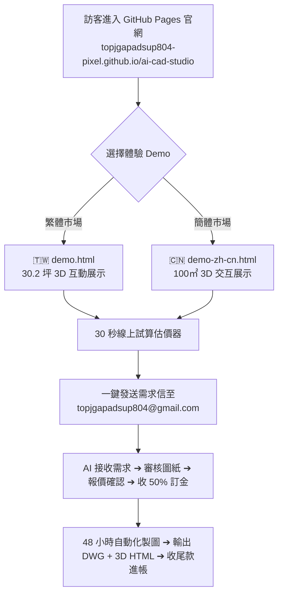

# 商業變現與開源策略規劃書 (DraftPro Studio Monetization Blueprint)

> **核心決策方針**：採行 **「Open-Core 技術展示 × 高客單統包付費製圖服務 (High-Ticket Productized Service)」** 混合變現模型。  
> 透過開源展示建立無可撼動的專業信任與自然流量，直接在線上將訪客轉化為每單 NT$3,500 ～ NT$28,000（$120 ～ $890 USD）的真實付費客戶。

---

## 一、 決策分析：開源 vs. 打包收費

| 評估維度 | 純打包封閉收費 (SaaS/軟體) | 純完全開源 (0 商業化) | **DraftPro 混合變現模型 (採行方針)** |
| :--- | :--- | :--- | :--- |
| **獲客阻力** | 極高。室內設計師與統包工班對不明軟體付費門檻極高。 | 極低。容易獲得 Stars，但 0 營收。 | **最低阻力**。直接提供可點擊的 3D 互動範例，點開即信服。 |
| **信任建立** | 難。需要反覆展示安全性與相容性。 | 高。代碼透明。 | **最高**。真實規範檢驗、符合 A3 字高與圖層規範，專業度立竿見影。 |
| **收費模式** | 訂閱制軟體（續訂率不確定） | 無 | **高客單案件交付 + 包月繪圖員服務 + 數位資產包**。 |
| **現金流入速度** | 慢（需產品成熟與金流串接） | 無 | **最快（首案即收 NT$ 3,500 ~ 9,800，48 小時內交件）**。 |

---

## 二、 雙版本定位與受眾市場 (Dual-Language Strategy)

專案全面支援繁簡雙版本，覆蓋跨區域市場：

1. **臺灣 / 香港市場（繁體版 `demo.html` / `demo-zh-tw.html`）**
   - **計量單位**：坪（Ping）、毫米（mm）
   - **標準圖說命名**：客餐廳、景觀陽台、工作陽台、主臥、次臥、書房、主衛、客衛
   - **鎖定客群**：臺灣室內設計工作室、統包工程行、老屋翻修統包商、房仲代銷
   - **主要接案管道**：Pro360 達人網、Tasker 104 出任務、Facebook 設計裝修社團、直接開發信

2. **大陸 / 國際華人市場（簡體版 `demo-zh-cn.html`）**
   - **計量單位**：平方米（㎡）、毫米（mm）
   - **標準圖說命名**：客餐厅、景观阳台、生活阳台、主卧、次卧、书房、主卫、公卫
   - **鎖定客群**：獨立設計師、裝修工作室、房地產海外展示
   - **主要接案管道**：小紅書作品展示、知乎專案分享、豬八戒/淘寶製圖店鋪合作

---

## 三、 三大真實收益來源 (Revenue Streams)

### 1. 統包繪圖與 3D 空間互動網頁交付（主力現金流）
客戶提供手繪草圖、建商格局圖、老舊圖紙或 PDF：
- **方案 A：單圖快出（急件放樣 / 舊圖翻新）**
  - 定價：**NT$ 3,500 / $120 USD**
  - 交付：標準可編輯 DWG + A3 排版 PDF，48 小時交付。
- **方案 B：戶型轉 3D 互動設計包（成交利器）**
  - 定價：**NT$ 9,800 / $300 USD**
  - 交付：完整平面配置 DWG + 專屬獨立 3D 互動空間網頁（支援手機/電腦漫遊、家具水電切換）+ 一頁式報價估算表。
- **方案 C：設計工作室包月合作（繪圖外包）**
  - 定價：**NT$ 28,000 / $890 USD 每月**
  - 交付：每月 10 張施工圖額度 + 2 戶 3D 互動提案 + 專屬圖框標準同步。

### 2. 數位資產包（Gumroad / 數位下載被動收入）
- **產品**：《AutoCAD 建築室內製圖規範範本庫 + 62 組 2D/3D 標準家具動態圖塊包》
- **定價**：$49 USD（約 NT$ 1,580）
- **交付型態**：下載即用之 `.dwg`、`.dxf` 與對應圖層規範手冊。

### 3. 海外 Upwork / Fiverr 國際案源接單
- **刊登項目**："Transform Floor Plan Sketch into Interactive 3D Web App & AutoCAD DWG in 48 Hours"
- **報價區間**：$150 - $450 USD / project。

---

## 四、 商業雙授權條款 (Dual-Licensing Model)

- **開源部分（MIT License）**：
  - 本儲存庫公開的 Demo 檢視器、規範生成範例代碼開源，供個人學習、交流與技術評估使用。
- **商用收費部分（Commercial License & Turnkey Service）**：
  - 企業、工作室將此系統整合至自有商業建案提案、委託客製化戶型繪圖、白標（White-label）移除浮水印商業交付，需委託團隊繪製或採購商用授權。

---

## 五、 接單與進帳漏斗 (Conversion Funnel)

---

## 六、 聯絡接案專用通道

- 官方接案信箱：`topjgapadsup804@gmail.com`
- 專案展示網址：https://topjgapadsup804-pixel.github.io/ai-cad-studio/
- GitHub Issue 需求提交：https://github.com/topjgapadsup804-pixel/ai-cad-studio/issues
